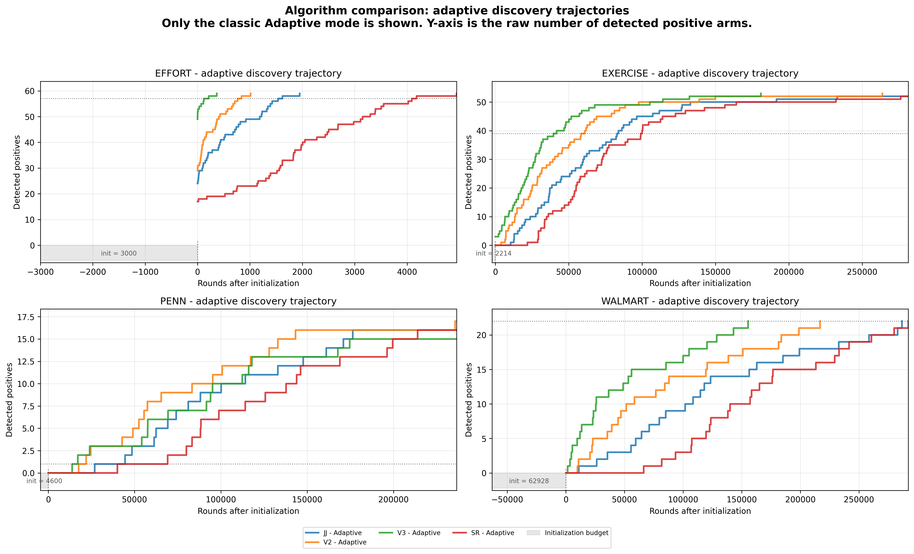

# Bandit Approach Simulation

[](https://github.com/Chams22/bandit_approach_simulation/actions/workflows/tests.yml)

Adaptive bandit algorithms for **sequential multiple testing with false discovery rate (FDR) control**, applied to simulated data and to **real behavioural megastudies** (vaccination nudges, physical activity). Based on Jamieson & Jain, *"A Bandit Approach to Sequential Experimental Design with False Discovery Control"* (NeurIPS 2018).

**In short:** instead of testing every treatment arm equally, the algorithm samples promising arms more often, while anytime-valid p-values and the Benjamini–Hochberg procedure keep the FDR below δ at every step. Result: the same set of effective treatments is found **with a much smaller sampling budget** than uniform allocation.

📄 Full report (in French): [`docs/rapport_bandits_adaptatifs_megaetudes.pdf`](docs/rapport_bandits_adaptatifs_megaetudes.pdf)

Master's research project, M1 Statistics & Data Science, University of Montpellier (2025–2026).
**Authors:** Ines Bahraoui, Chams-Eddine Bouaziz, Marouane Daoudi · **Supervisors:** Adrien Nguyen-Huu, Luka Boisgibault

---

## Key results

Budget saved by adaptive vs uniform allocation to reach the **same** set of discoveries, on the four real megastudies (positive = adaptive is faster):


Discovery trajectories of the four algorithms (JJ, V2, V3, SR) on each dataset:



---

## Getting started

**Install dependencies:**
```bash
pip install -r requirements.txt
```

**Run the tests:**
```bash
pip install pytest
pytest -q tests
```

**Launch the Streamlit app:**
```bash
streamlit run streamlit_visu/app_bandit.py
```

---

## Repository structure

```
├── backend/                        # Algorithm implementations
│   ├── adaptative_algorithm_jj.py          # JJ — LIL-based anytime p-values (Jamieson & Jain)
│   ├── adaptative_algorithm_v2.py          # V2 — Normal Mixture closed-form p-values
│   ├── adaptative_algorithm_continuous_v3.py   # V3 — Betting martingale (continuous data)
│   ├── adaptative_algorithm_binary_v3.py       # V3 — Betting martingale (binary/Bernoulli)
│   ├── adaptative_algorithm_successive_reject.py  # SR — Successive Rejects (best-arm identification)
│   └── real_data_processing.py             # Pipeline for real megastudy data
│
├── tests/                          # Smoke tests (run by GitHub Actions on every push)
├── docs/                           # Project report (PDF)
├── streamlit_visu/
│   └── app_bandit.py               # Interactive Streamlit app (simulation + visualisation)
│
├── data/                           # Real megastudy datasets (raw, processed, estimates)
├── figure_*/                       # Saved experiment figures
└── saved_results/                  # Saved simulation outputs
```

---

## Algorithms

| Name | Module | P-value method | Notes |
|------|--------|---------------|-------|
| **JJ** | `adaptative_algorithm_jj.py` | LIL confidence sequences (brentq inversion) | Original Jamieson & Jain 2018 |
| **V2 / NM** | `adaptative_algorithm_v2.py` | Normal Mixture closed-form | More powerful than LIL bounds |
| **V3** | `adaptative_algorithm_continuous_v3.py` | Betting martingale (Ville's inequality) | Strongest anytime guarantee |
| **SR** | `adaptative_algorithm_successive_reject.py` | None (elimination-based) | Fixed-budget best-arm identification |

Each algorithm runs in two modes:
- **Adaptive** — UCB-based arm selection, samples more from promising arms
- **Uniform** — equal allocation baseline

FDR control is achieved via the **Benjamini-Hochberg (BH)** procedure at each time step.

---

## Streamlit app features

- **Single simulation** — run one algorithm (JJ / V2 / V3 / SR) and compare adaptive vs uniform
- **Algorithm comparison** — run all algorithms on the same shared data for fair comparison
- **Batch testing** — queue and run multiple configurations
- **Visualisations** — TPR curves, pull distribution, spaghetti plots, p-value grids, bootstrap CIs, detection order, exact discovery sequences (Kendall τ heatmap)
- **Metrics** — TPR@90%, Gain d'efficacité, ΔAUC, Cohen's D (δ/σ), FDR

---

## Reference

Jamieson, K., & Jain, L. (2018). *A Bandit Approach to Sequential Experimental Design with False Discovery Control*. NeurIPS 2018.
